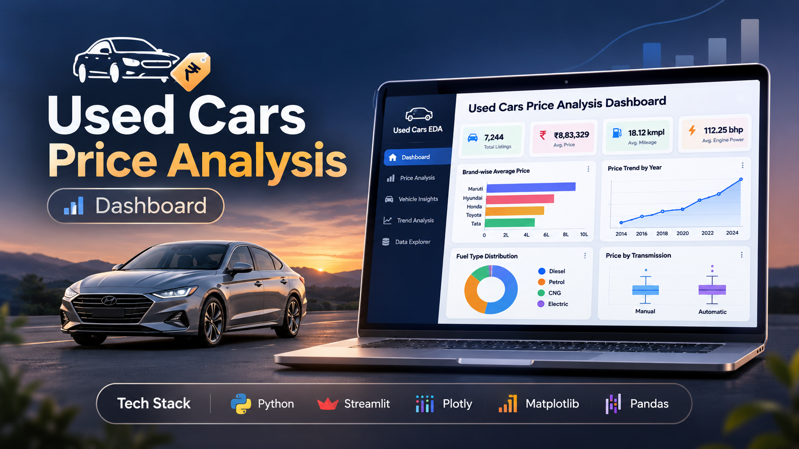

# Used Cars Price Analysis Dashboard

An interactive **Exploratory Data Analysis (EDA) dashboard** built with Python and Streamlit to analyze used car prices, identify market trends, and understand the factors influencing vehicle resale value.

**[Live Dashboard](https://usedcardataset.streamlit.app/)** | **[GitHub Repository](https://github.com/sahilkarande/Used-Cars-EDA)**

## Dashboard Preview



## Project Overview

The dashboard analyzes used car listings to explore pricing patterns across vehicle brands, fuel types, transmission, mileage, engine capacity, ownership history, and location.

It provides interactive visualizations and data-driven insights to support better decision-making for buyers, sellers, and dealerships.

## Key Performance Indicators

| Metric | Value |
|---|---|
| Total Car Listings | 7,244 |
| Average Price | ₹8,83,329 |
| Average Mileage | 18.12 kmpl |
| Average Engine Power | 112.25 bhp |
| Most Common Fuel Type | Diesel |
| Most Listed Brand | Maruti |

## Key Insights

- **Brand & Location:** Vehicle prices vary significantly across brands and geographic locations.
- **Fuel Type:** Diesel vehicles generally command slightly higher prices.
- **Transmission:** Automatic cars tend to be more expensive, particularly newer models.
- **Ownership:** First-owner vehicles typically retain higher resale values.
- **Engine & Power:** Higher engine capacity and power generally correlate with increased prices.

## Dashboard Features

- **Interactive Filters:** Brand, location, fuel type, transmission, ownership, and price range.
- **Price Analysis:** Distribution of vehicle prices and brand-wise comparisons.
- **Vehicle Insights:** Mileage, engine power, fuel type, and transmission analysis.
- **Trend Analysis:** Year-wise pricing patterns and numerical correlations.
- **KPI Dashboard:** Summary metrics and key market statistics.
- **Data Explorer:** Interactive dataset preview and vehicle comparisons.

## Technology Stack

| Category | Technologies |
|---|---|
| Programming | Python |
| Data Processing | Pandas, NumPy |
| Visualization | Plotly, Matplotlib, Seaborn |
| Dashboard Framework | Streamlit |
| Deployment | Streamlit Community Cloud |

## Installation & Setup

**1. Clone the repository**

```bash
git clone https://github.com/sahilkarande/Used-Cars-EDA.git
cd Used-Cars-EDA
```

**2. Install dependencies**

```bash
pip install pandas numpy matplotlib seaborn plotly streamlit
```

**3. Run the dashboard**

Ensure the cleaned dataset (`used_cars_cleaned.csv`) is available in the required directory.

```bash
streamlit run streamlit_app.py
```

The dashboard will be accessible at `http://localhost:8501`.

## Future Enhancements

- Machine learning-based used car price prediction.
- Advanced market segmentation and comparative analysis.
- Automated data updates and real-time pricing insights.

---

**Explore the Dashboard:** https://usedcardataset.streamlit.app/
